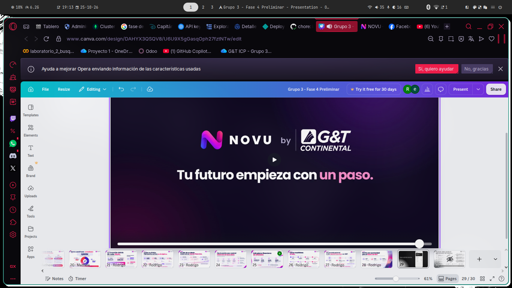
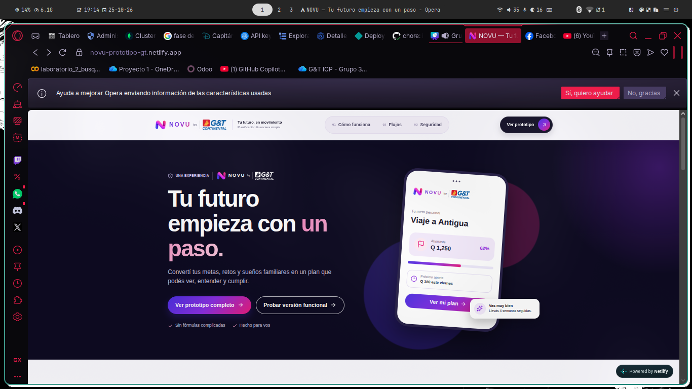
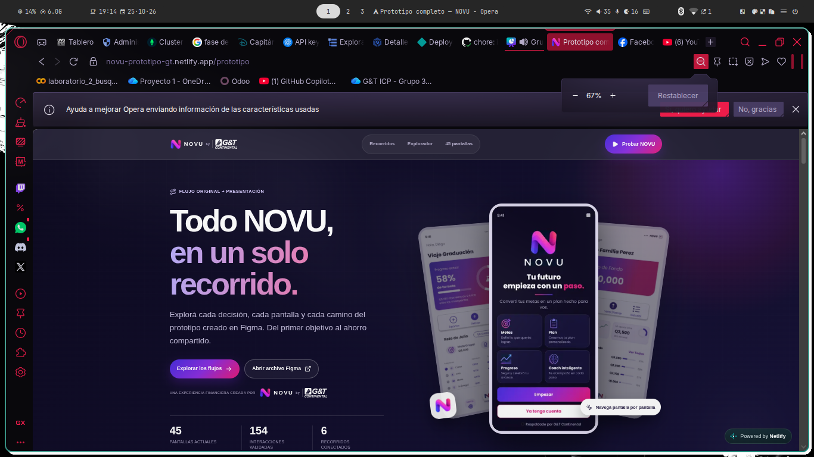

## Cambios 

## 1
Primero el benchmark es este

COmo ves dice Tu futuro comienza con un paso. 

## 2

Este encabezado no me gusta como aparece la app y el header dea rriba, mejor ponlo como el de 

Prototipo completo, adicional quita el boton de ver prototipo completo solo deja prototipo version funcional.

## 3

Necesito que en el apartado de Conocé cómo NOVU se conectará con el ecosistema del banco. en /tecnologia

agregues el como funciona la estructura del chatbot.

.png>)

LO mejor seria utilizar el mismo color y estilo para representar esta arquitectura y explicar como funciona el chatbot. 

## 4

La version funcional esta dise;ada para navegadores pero los del gyt usaran sus celulares entonces debemos de adaptar la version funcional a estos. Usa como guia lo mostrado en /prototipo en como serian los dise;o, incluyendo el navigation bar tipo mobil que si o si debe de estar. 

EL punto no es duplicar las pesta;as una por una sino que sean como parte de estas. Es adaptar la version funcional para esto. 

## Implementación

- [x] **1. Mensaje y marca:** se conserva «Tu futuro empieza con un paso», tal como aparece en la imagen de referencia. Se incorporó Poppins local con su licencia para que la tipografía sea consistente.
- [x] **2. Encabezado y pantallas:** siguiendo la aclaración, la portada comparte con `/prototipo` el mismo componente de encabezado, estilos oscuros y composición de las tres pantallas originales. La llamada principal es «Probar versión funcional»; se retiró la alternativa de prototipo completo de ese encabezado y de la portada principal.
- [x] **3. Chatbot:** `/tecnologia` incluye el recorrido interactivo de la arquitectura híbrida propuesta: mensaje y contexto, JEV, clasificación de alcance, solicitudes parciales, catálogo, routing, configuración, ejecución, LLM, presentación y respuesta. Se pueden explorar consultas válidas, parciales y fuera de alcance. Se distingue esa propuesta del alcance actual de la demo.
- [x] **4. Celulares:** la versión funcional adapta las mismas pantallas y flujos, con tarjetas compactas, progreso circular, formularios y chat. Incorpora navegación inferior fija de cinco apartados: Inicio, Metas, NOVU, Ritmo y Menú. El menú permite acceder también a retos, fondo familiar y oportunidades. En escritorio se conserva la navegación lateral; el registro y el acceso mantienen su flujo propio.

### Verificación

- 40 pruebas del frontend aprobadas, incluidas navegación móvil, acceso por contraseña y los tres ejemplos del chatbot.
- ESLint, TypeScript y build de producción aprobados.
- 90 vistas revisadas con Playwright en la compilación de producción, a 320, 375, 390, 844, 1024 y 1440 píxeles; el caso de 844 se revisó en horizontal.
- Sin errores de JavaScript, desbordamiento horizontal ni superposición de la barra inferior sobre el campo de escritura del chat en esas vistas.
- La revisión en navegador utilizó respuestas de API simuladas; no creó usuarios ni movimientos en Atlas.

### Historial de conversaciones del Copiloto

- Se agregó «Historial» para abrir conversaciones anteriores y «Nueva conversación» para iniciar un chat independiente.
- Las conversaciones y los mensajes permanecen en MongoDB, asociados al usuario autenticado. Se abre la conversación más reciente al entrar al Copiloto.
- Cada conversación nueva toma su título de la primera consulta. Los borradores se conservan al cambiar de conversación durante la sesión.
- El historial carga más conversaciones por páginas; los chats largos permiten recuperar mensajes anteriores. En celular, el historial ocupa el espacio del chat y permite volver a él.
- No requiere nuevas variables de entorno, secretos ni colecciones. Para publicarlo se deben desplegar los cambios de frontend y backend.
- Verificación: 48 pruebas del frontend y 39 del backend aprobadas; ESLint, TypeScript y compilación de producción aprobados. Se revisaron 24 vistas en seis tamaños de pantalla con API simulada, sin errores de JavaScript ni desbordamientos o superposición de la navegación sobre el campo de escritura.

